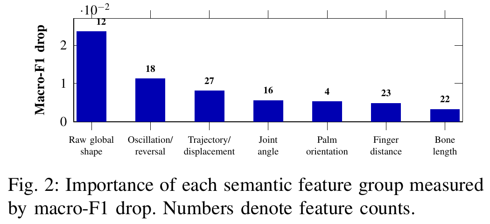
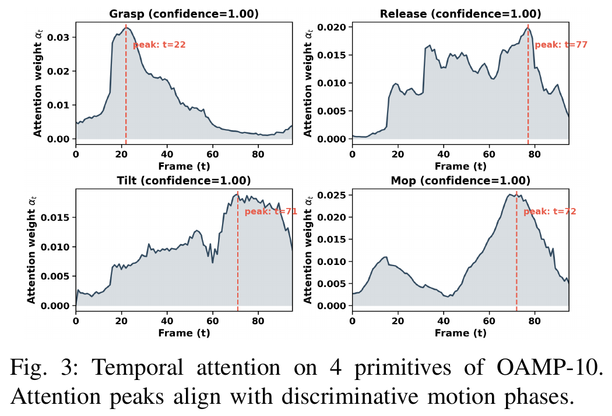
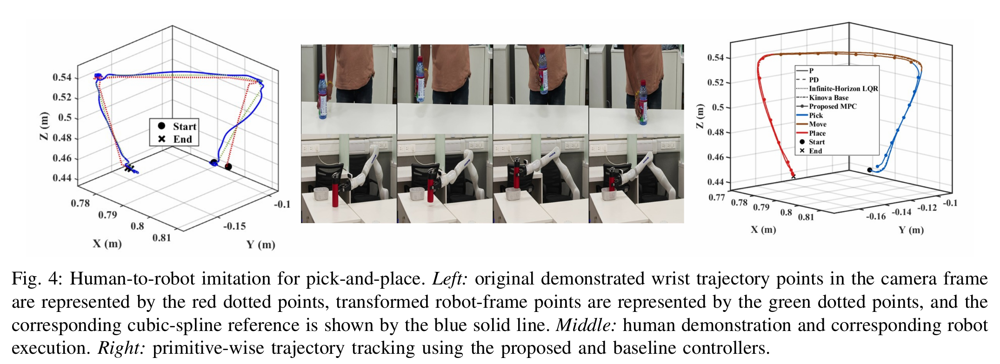
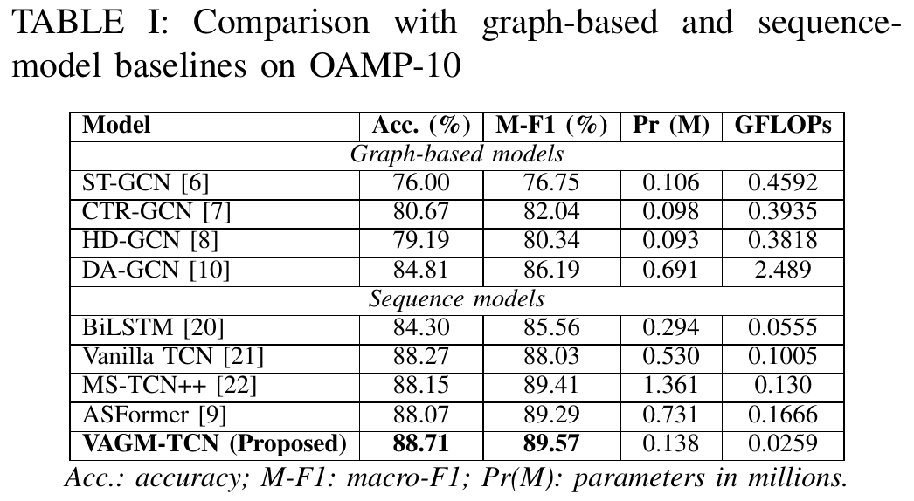
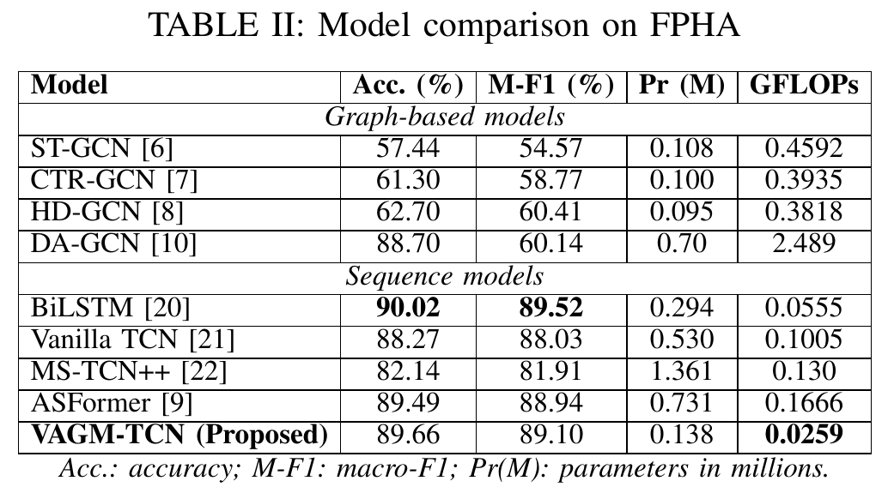
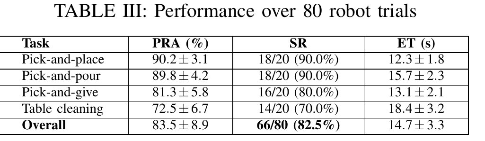
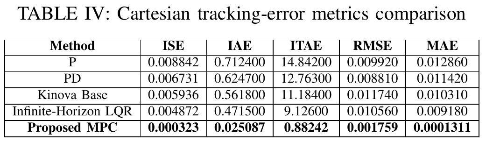

# Step 6: results reported in the paper

This folder shows the paper's results exactly as published. Every image here was cut directly from the submitted paper PDF at 300 dpi, so the numbers and plots are the same as in the paper. The tables are also typed out below so they can be read and searched without opening the images.

This repository does not include the training or testing code that produced these results.

```
06_paper_results/
├── figures/
│   ├── fig1_pipeline_overview.png          Fig. 1  the full framework, from video to robot
│   ├── fig2_group_importance.png           Fig. 2  macro-F1 drop when each feature group is removed
│   ├── fig3_temporal_attention.png         Fig. 3  where the model looks in time, for 4 primitives
│   └── fig4_human_to_robot_imitation.png   Fig. 4  pick-and-place, from the human demo to the robot
└── tables/
    ├── table1_oamp10_comparison.png        Table I    recognition on this dataset (OAMP-10)
    ├── table2_fpha_comparison.png          Table II   recognition on the FPHA benchmark
    ├── table3_robot_trials.png             Table III  80 robot trials
    └── table4_tracking_errors.png          Table IV   robot trajectory tracking errors
```

## Fig. 1: overview of the framework


Steps 1 to 5 of this repository cover the "Hand Landmarks" and "Kinematic Features" boxes. The recognition model (VAGM-TCN) and the robot execution part are described in the paper.

## Fig. 2: importance of each feature group



Each of the 16 groups from step 5 was removed in turn, and the drop in macro-F1 was measured. The 7 groups shown here mattered most and were kept, giving 122 features. The number above each bar is how many features are in that group.

## Fig. 3: temporal attention



The attention weight shows which of the 96 frames the model relies on most. The peaks are at frame 22 for Grasp, 77 for Release, 71 for Tilt and 72 for Mop.

## Fig. 4: human-to-robot imitation



## Table I: recognition on OAMP-10



| Model | Acc. (%) | M-F1 (%) | Pr (M) | GFLOPs |
|---|---|---|---|---|
| *Graph-based models* | | | | |
| ST-GCN | 76.00 | 76.75 | 0.106 | 0.4592 |
| CTR-GCN | 80.67 | 82.04 | 0.098 | 0.3935 |
| HD-GCN | 79.19 | 80.34 | 0.093 | 0.3818 |
| DA-GCN | 84.81 | 86.19 | 0.691 | 2.489 |
| *Sequence models* | | | | |
| BiLSTM | 84.30 | 85.56 | 0.294 | 0.0555 |
| Vanilla TCN | 88.27 | 88.03 | 0.530 | 0.1005 |
| MS-TCN++ | 88.15 | 89.41 | 1.361 | 0.130 |
| ASFormer | 88.07 | 89.29 | 0.731 | 0.1666 |
| **VAGM-TCN (Proposed)** | **88.71** | **89.57** | 0.138 | 0.0259 |

Acc.: accuracy. M-F1: macro-F1. Pr (M): parameters in millions.

## Table II: recognition on FPHA



| Model | Acc. (%) | M-F1 (%) | Pr (M) | GFLOPs |
|---|---|---|---|---|
| *Graph-based models* | | | | |
| ST-GCN | 57.44 | 54.57 | 0.108 | 0.4592 |
| CTR-GCN | 61.30 | 58.77 | 0.100 | 0.3935 |
| HD-GCN | 62.70 | 60.41 | 0.095 | 0.3818 |
| DA-GCN | 88.70 | 60.14 | 0.70 | 2.489 |
| *Sequence models* | | | | |
| BiLSTM | **90.02** | **89.52** | 0.294 | 0.0555 |
| Vanilla TCN | 88.27 | 88.03 | 0.530 | 0.1005 |
| MS-TCN++ | 82.14 | 81.91 | 1.361 | 0.130 |
| ASFormer | 89.49 | 88.94 | 0.731 | 0.1666 |
| **VAGM-TCN (Proposed)** | 89.66 | 89.10 | 0.138 | **0.0259** |

## Table III: performance over 80 robot trials



| Task | PRA (%) | SR | ET (s) |
|---|---|---|---|
| Pick-and-place | 90.2 ± 3.1 | 18/20 (90.0%) | 12.3 ± 1.8 |
| Pick-and-pour | 89.8 ± 4.2 | 18/20 (90.0%) | 15.7 ± 2.3 |
| Pick-and-give | 81.3 ± 5.8 | 16/20 (80.0%) | 13.1 ± 2.1 |
| Table cleaning | 72.5 ± 6.7 | 14/20 (70.0%) | 18.4 ± 3.2 |
| **Overall** | 83.5 ± 8.9 | **66/80 (82.5%)** | 14.7 ± 3.3 |

PRA: primitive recognition accuracy. SR: success rate. ET: execution time.

## Table IV: Cartesian tracking errors



| Method | ISE | IAE | ITAE | RMSE | MAE |
|---|---|---|---|---|---|
| P | 0.008842 | 0.712400 | 14.84200 | 0.009920 | 0.012860 |
| PD | 0.006731 | 0.624700 | 12.76300 | 0.008810 | 0.011420 |
| Kinova Base | 0.005936 | 0.561800 | 11.18400 | 0.011740 | 0.010310 |
| Infinite-Horizon LQR | 0.004872 | 0.471500 | 9.12600 | 0.010560 | 0.009180 |
| **Proposed MPC** | **0.000323** | **0.025087** | **0.88242** | **0.001759** | **0.0001311** |
