# Step 7: model testing and comparison

This folder shows how the recognition model (VAGM-TCN) was tested and how it compares with other models. It holds plots only. The training and testing code is not in this repository.

```
07_model_testing_and_comparison/
├── comparison/               VAGM-TCN against 8 other models, drawn from the paper's Tables I and II
├── training_curves/          how accuracy and loss changed while the final model trained
├── learned_features/         t-SNE maps of what the model learned, one dot per test clip
└── continuous_recognition/   the model run on uncut videos: primitive timeline and wrist path
```

Where the plots come from:

- `comparison/`: drawn for this repository from the numbers printed in the paper, so they match Tables I and II exactly. The tables themselves are in `06_paper_results/`.
- The other three folders: the saved outputs of the final model (hidden size 64, random seed 42).

## How the models were tested

Every model saw exactly the same data:

- **Data.** The same 9,000 clips and the same grouped split from step 4 (6,300 train / 1,350 validation / 1,350 test). A recording and its augmented copies are always on the same side of the split, so no test clip has a copy in training.
- **Inputs.** The sequence models (BiLSTM, Vanilla TCN, MS-TCN++, ASFormer, VAGM-TCN) read the same 122 selected features per frame. The graph models (ST-GCN, CTR-GCN, HD-GCN, DA-GCN) read the 21 hand landmarks from step 2, connected as a hand skeleton, because that is the input those models are built for.
- **Choosing the checkpoint.** Training stops early when validation macro-F1 has not improved for 15 epochs, and the epoch with the best validation macro-F1 is kept.
- **The test.** The test split is used once, at the end, on that kept checkpoint.

Two scores are reported:

- **Accuracy** is the share of test clips labelled correctly.
- **Macro-F1** is the F1 score worked out for each of the 10 classes separately and then averaged. Every class counts equally in it, so it shows whether some classes are being missed.

Cost is reported in three ways:

- **Parameters:** how many numbers the model learns.
- **GFLOPs:** billions of arithmetic operations to classify one 96-frame clip.
- **Inference time:** milliseconds per clip.

For FPHA (Table II), every model was trained again from scratch on the FPHA training split. FPHA is a public hand-action benchmark with 45 classes. The features and settings were the same as for OAMP-10.

## Comparison

### OAMP-10: accuracy and macro-F1

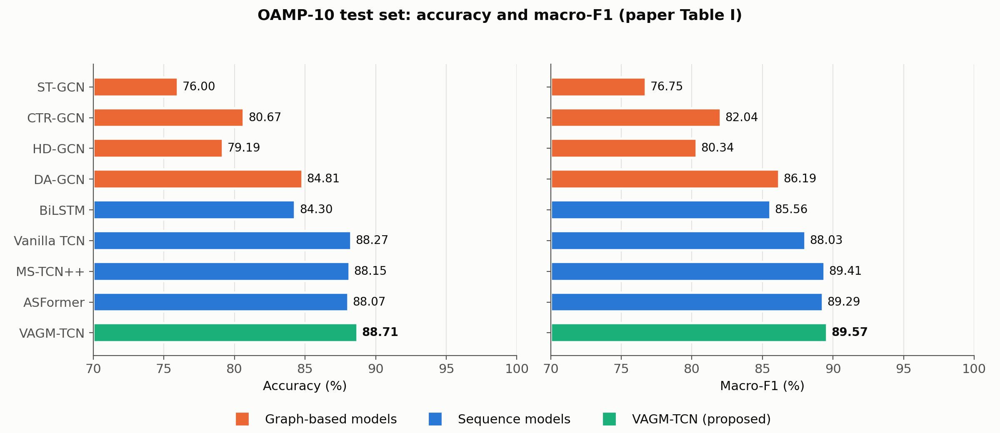

VAGM-TCN has the highest accuracy (88.71%) and the highest macro-F1 (89.57%) of the nine models.

- **Graph models.** These model the hand as a skeleton, and they score lowest: 76.00% to 84.81% accuracy. On this dataset the classes are told apart mainly by how the hand moves over time, so an explicit skeleton model helps less.
- **Temporal-convolution models** (Vanilla TCN, MS-TCN++) and ASFormer come within about one point of VAGM-TCN.

### OAMP-10: score against cost

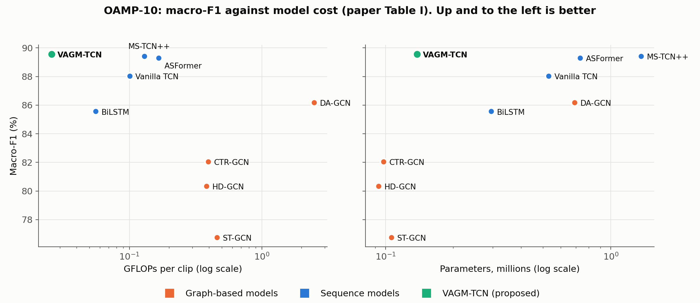

The x-axes are on a log scale, and the best place to be is the top left: high score, low cost.

- **Compute.** VAGM-TCN needs 0.0259 GFLOPs per clip, the least of all nine models. That is about 4 to 6 times fewer than Vanilla TCN, MS-TCN++ and ASFormer, and about 96 times fewer than DA-GCN.
- **Size.** It has 0.138M parameters. ST-GCN, CTR-GCN and HD-GCN are slightly smaller, at 0.09 to 0.11M, but they score 7 to 13 points lower in macro-F1.

### FPHA: accuracy and macro-F1

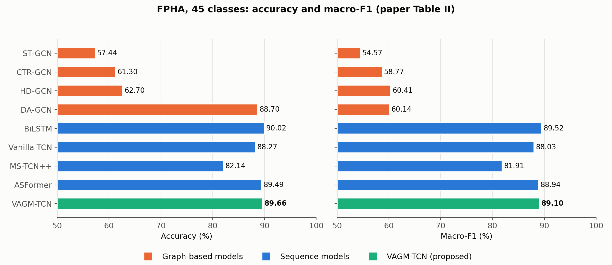

On FPHA (45 classes, reconstructed 1:1 split), VAGM-TCN reaches 89.66% accuracy and 89.10% macro-F1.

- **BiLSTM** is slightly higher (90.02 / 89.52), but it costs about twice the GFLOPs and parameters.
- **DA-GCN** has high accuracy (88.70%) but a low macro-F1 (60.14%). It does well on the common classes and poorly on many of the others.

### FPHA: score against cost

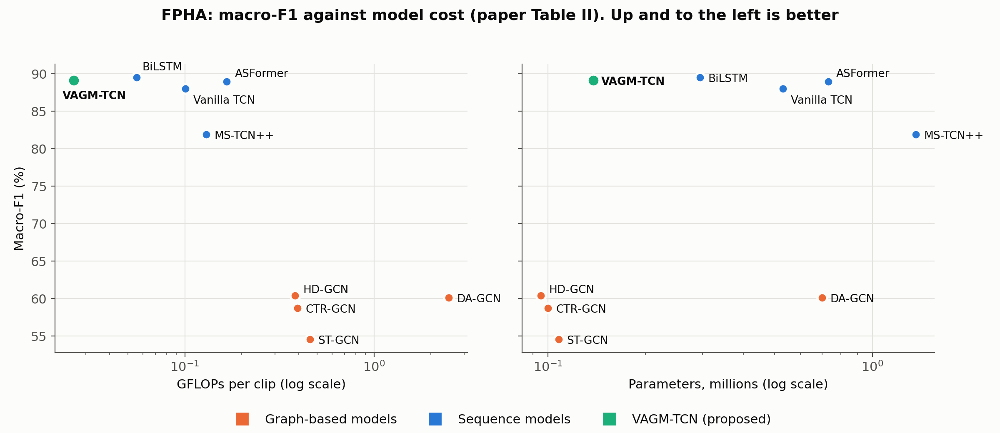

## Training curves of the final model

| Accuracy | Loss |
|---|---|
| 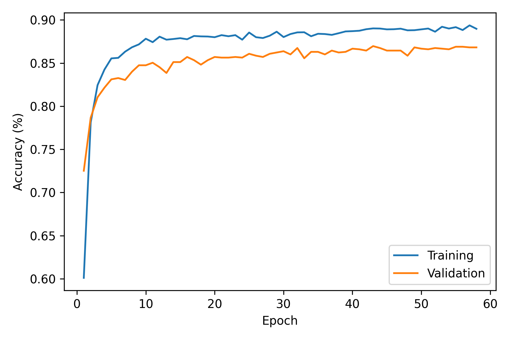 | 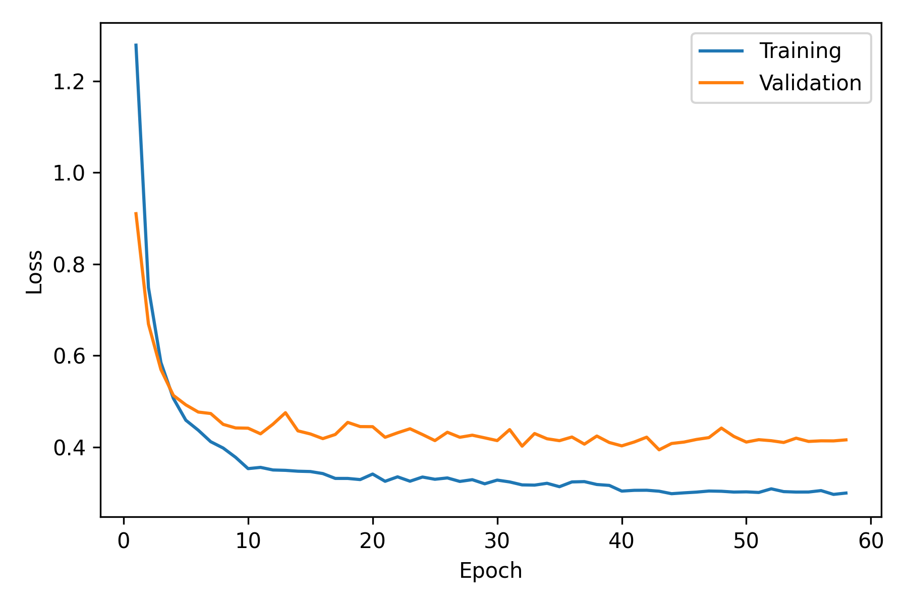 |

These show training and validation accuracy and loss for each epoch of the final run.

- **How the run went.** Training stopped after 58 epochs, and the checkpoint from epoch 43 (best validation macro-F1) was kept.
- **What the curves show.** The validation curves level off by about epoch 20 and stay close to the training curves, so the model is not badly overfitting.
- **Why training accuracy stays under 100%.** Validity-aware group masking switches off whole feature groups for some training clips, so the model is trained on harder versions of the clips than it is tested on.

## What the model learned (t-SNE)

| 2-D | 3-D |
|---|---|
| 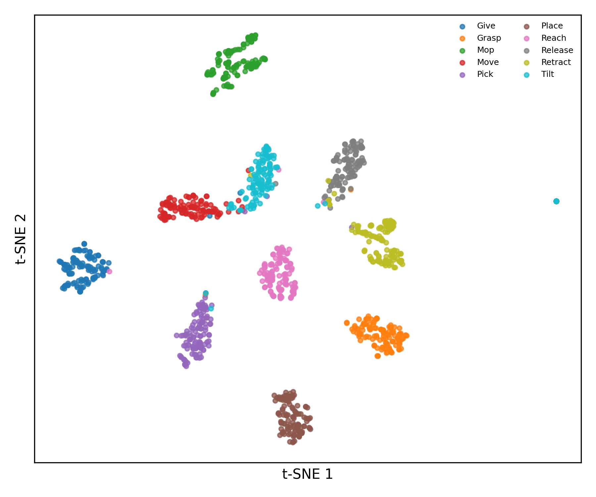 | 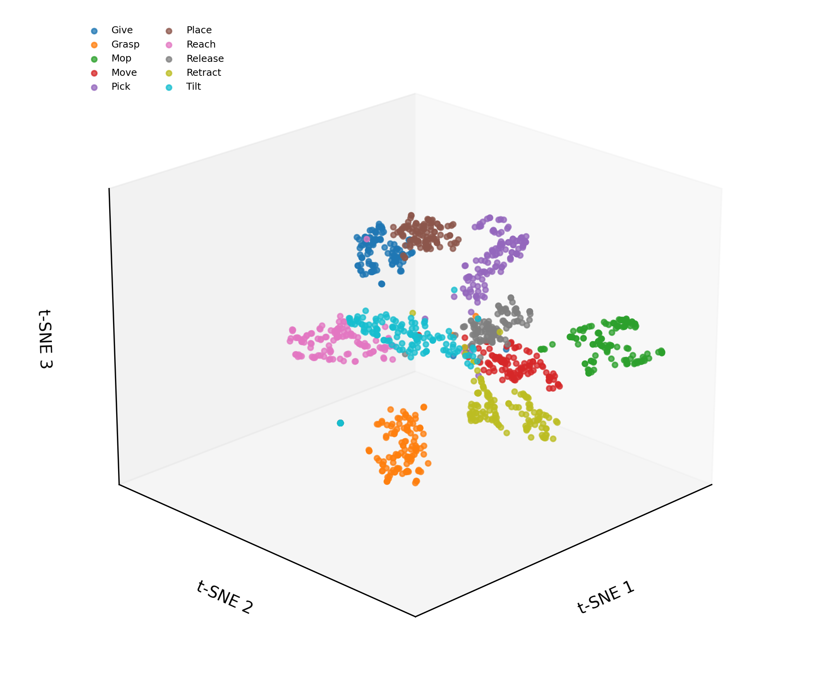 |

The model was run on the test clips. For each clip, the 64-number summary it builds after attention pooling (the vector the classifier reads) was taken. t-SNE squeezes those 64 numbers into 2 or 3 so they can be plotted, keeping clips that were close together close on the plot.

- **Mostly clean clusters.** Each class forms its own cluster. Mop, Give, Grasp and Place are cleanly separated.
- **Where clusters meet.** The few places where clusters touch, such as Tilt with Release and Move, are the pairs that look alike in motion.

## Continuous recognition on uncut videos

The model is trained on short clips that each hold one primitive, but a real demonstration is one long video. To handle that, a 96-frame window slides along the video 8 frames at a time and is classified at each position. Neighbouring windows with the same label are then merged into one segment. The result is the ordered list of primitives, which says what the robot should do. The wrist's 3-D path over the same frames, coloured by primitive, says how the motion was done.

| Task | Primitive timeline | Wrist path coloured by primitive |
|---|---|---|
| Pick and place | 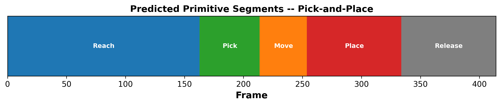 | 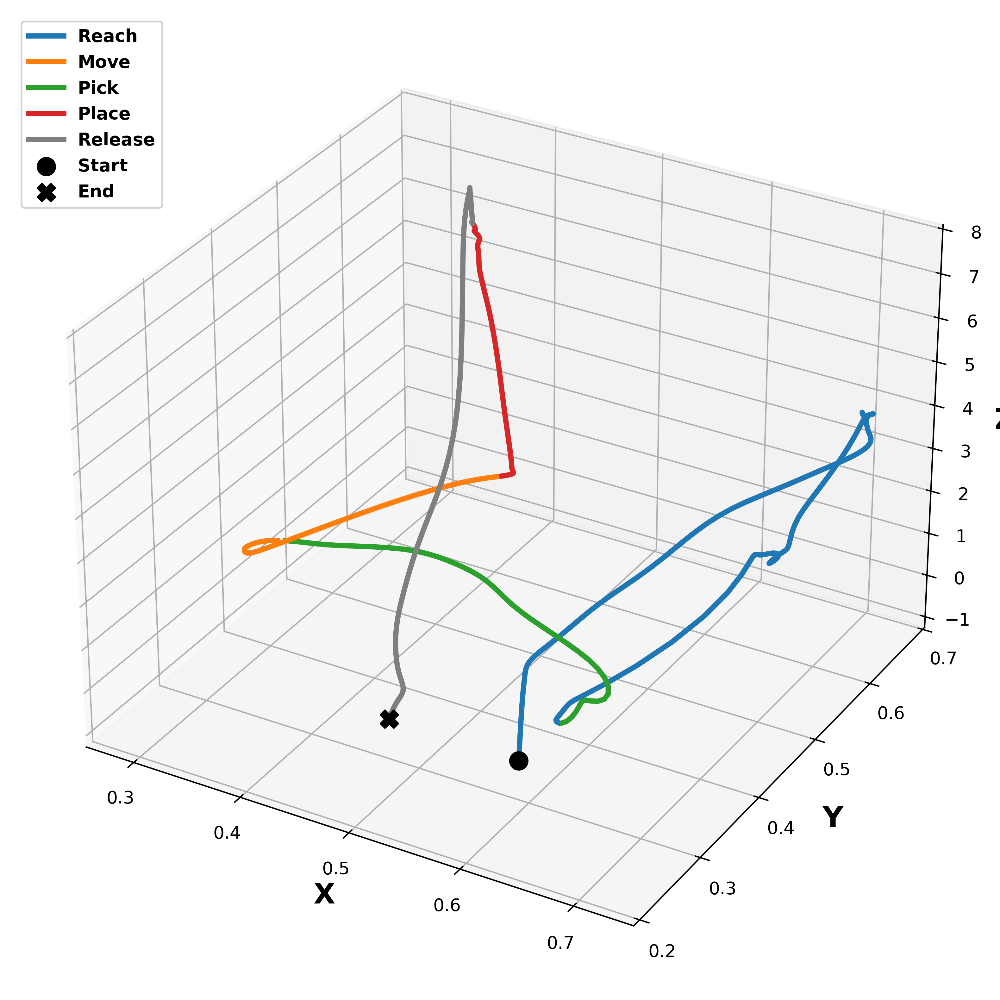 |
| Pick and give | 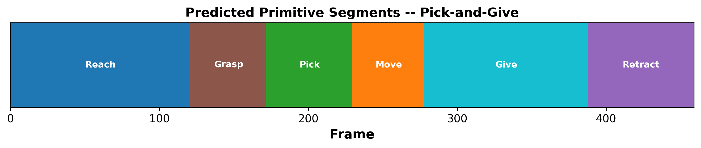 | 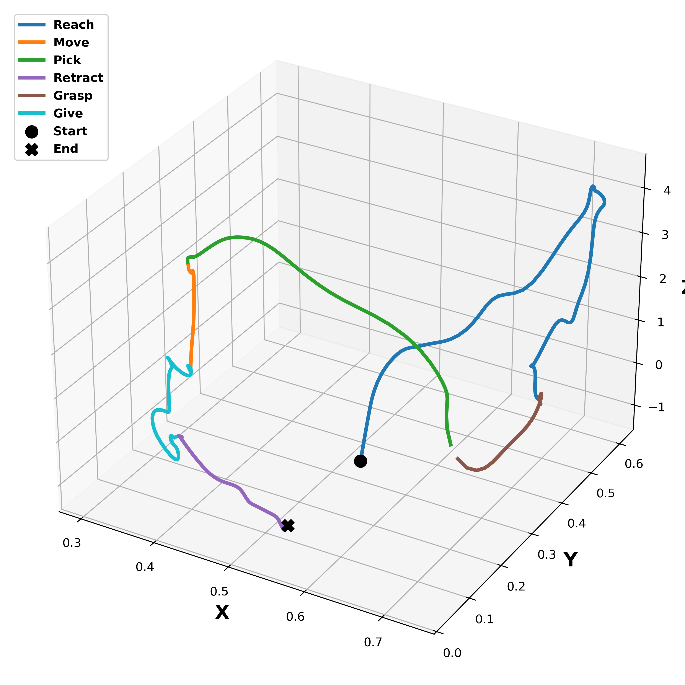 |
| Pick and pour (tilt) | 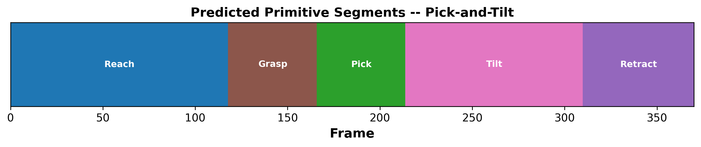 | 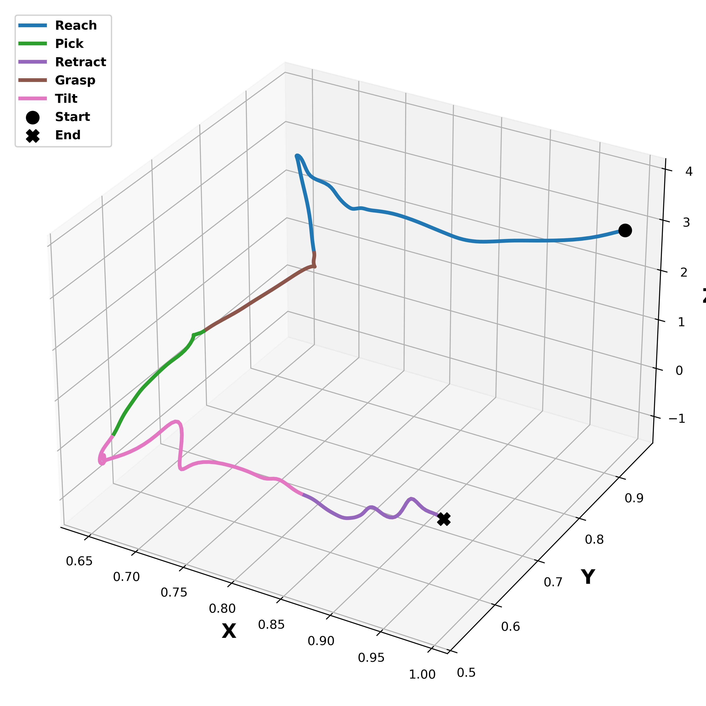 |
| Mopping | 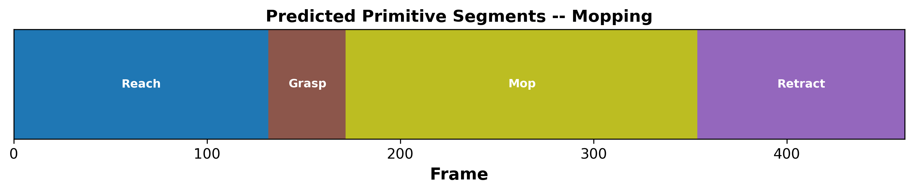 | 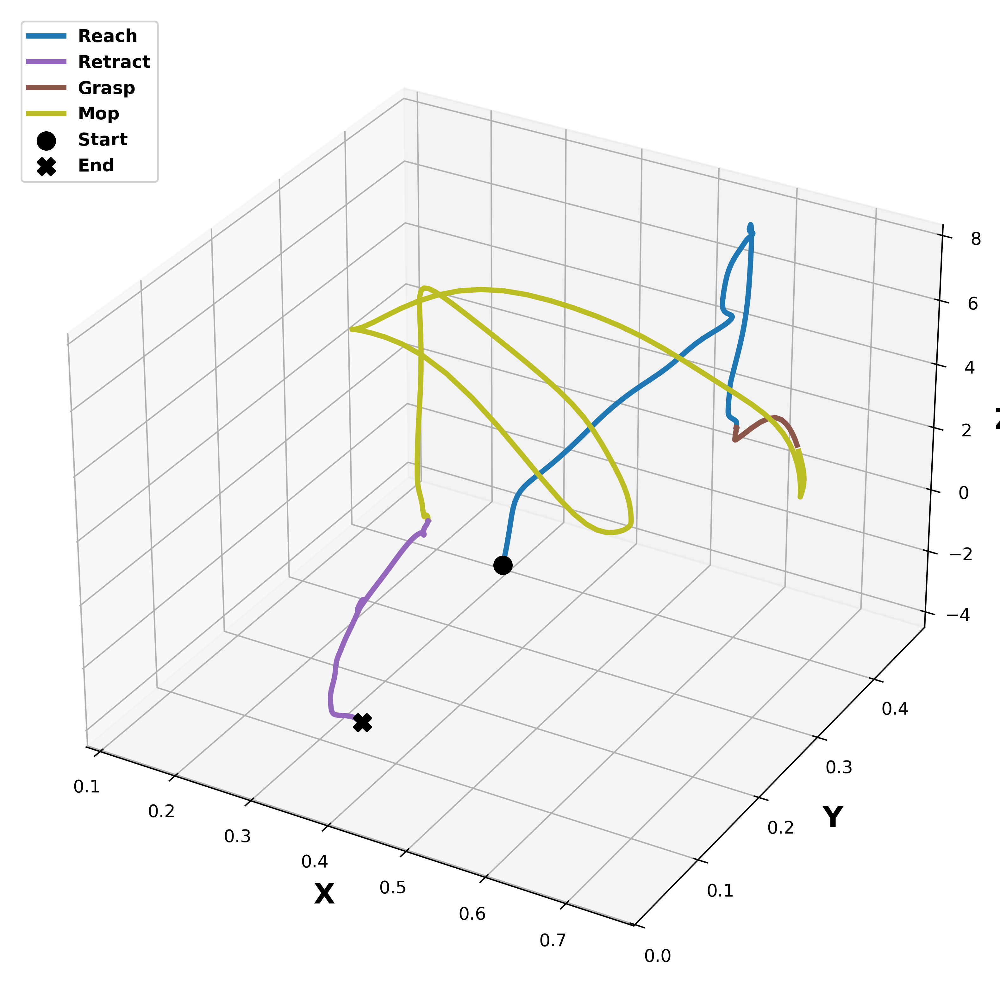 |

All four tasks start with Reach and then Grasp or Pick, and they differ in the primitives that follow (Place, Give, Tilt, Mop). The model recovers each task's sequence without having been trained on whole tasks, only on single primitives.

## Where the attention and feature-group plots are

The paper's Fig. 2 (which feature groups matter) and Fig. 3 (which frames the model attends to) are in `06_paper_results/figures/`, and `06_paper_results/README.md` explains them.
