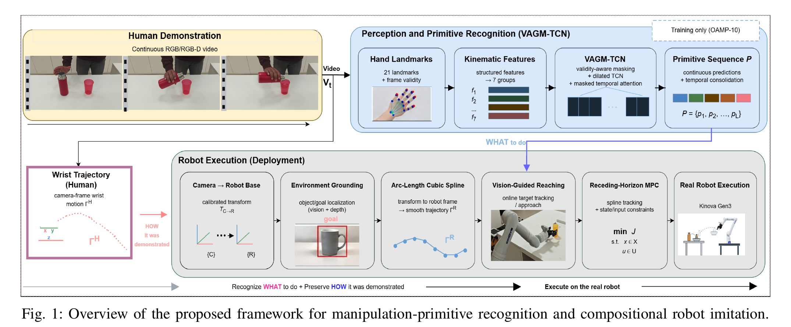

# Manipulation primitive recognition from hand landmarks: dataset, preprocessing and results

This repository goes with the paper *Learning the "What" and "How" of Manipulation for Human Demonstration-to-Robot Imitation*. A person shows a task to an ordinary camera, for example picking up a bottle and pouring it. The system works out two things:

- **What** was done: the ordered list of basic hand actions (Reach, Grasp, Pick, Tilt, ...).
- **How** it was done: the path the wrist followed.

A robot arm then repeats the task using those two pieces.

The repository contains the dataset (called OAMP-10 in the paper: Object-Agnostic Manipulation Primitives, 10 classes), all the preprocessing code that turns a video into model inputs, and the paper's results as tables and plots. It does **not** contain the model training or testing code, or trained models.

This README follows the order the work happens: installation first, then every processing step from video to features to feature groups, then how the features were reduced, how the model works, and how it was tested.



## Contents

1. [How the whole system works](#how-the-whole-system-works)
2. [Repository layout](#repository-layout)
3. [Setup: install the packages](#setup-install-the-packages)
4. [The pipeline, step by step](#the-pipeline-step-by-step)
   - [Step 1. Record the demonstrations](#step-1-record-the-demonstrations-01_raw_videos)
   - [Step 2. Find the hand in every frame, and check each frame is valid](#step-2-find-the-hand-in-every-frame-and-check-each-frame-is-valid-02_landmark_extraction)
   - [Step 3. Fill gaps (interpolation), smooth, and compute 196 features](#step-3-fill-gaps-interpolation-smooth-and-compute-196-features-03_feature_extraction)
   - [Step 4. Split into training, validation and test](#step-4-split-into-training-validation-and-test-04_train_val_test_split)
   - [Step 5. Sort the features into 16 semantic groups, 196 → 188](#step-5-sort-the-features-into-16-semantic-groups-196--188-05_semantic_feature_groups)
   - [Step 6. Measure which groups matter, and reduce to 122 features](#step-6-measure-which-groups-matter-and-reduce-to-122-features-no-code-here)
   - [Step 7. The recognition model, VAGM-TCN: training and testing](#step-7-the-recognition-model-vagm-tcn-training-and-testing-no-code-here)
   - [Step 8. Compare with other models](#step-8-compare-with-other-models-no-code-here)
   - [Step 9. Test on a public benchmark, FPHA](#step-9-test-on-a-public-benchmark-fpha-no-code-here)
   - [Step 10. Recognize primitives in uncut videos](#step-10-recognize-primitives-in-uncut-videos-no-code-here)
   - [Step 11. Robot execution](#step-11-robot-execution-no-code-here)
5. [Loading a clip in Python](#loading-a-clip-in-python)
6. [Following one clip through every step](#following-one-clip-through-every-step)
7. [The 10 classes](#the-10-classes)
8. [Results in brief](#results-in-brief)

## How the whole system works

Fig. 1 shows the full system. Read it from the top left.

1. **Human demonstration (yellow box).** A person does the task once in front of a normal RGB camera. Nothing is attached to the hand.
2. **Hand landmarks.** In every frame, Google's MediaPipe Hands finds 21 points on the hand: the wrist, the knuckles, the finger joints and the fingertips. Each frame also gets a yes/no flag saying whether a hand was found at all. This flag matters later.
3. **Kinematic features.** Frames where the hand was missed are filled in, and the 21 points are turned into 196 numbers per frame that describe the motion and the hand's shape: how far and how fast the wrist has moved, whether it is going back and forth, how open the hand is, how bent each finger is, which way the palm faces. 8 of them only describe tracking quality and time and are set aside. The other 188 are sorted into 16 named groups, and the 7 groups that matter most are kept, which leaves 122 numbers per frame.
4. **VAGM-TCN.** The recognition model reads 96 frames of those 122 numbers and says which of the 10 primitives it is.
5. **Primitive sequence.** On a long, uncut video, the model looks at a 96-frame window, slides it forward 8 frames, and looks again. Neighbouring windows with the same answer are merged, which gives an ordered list such as Reach → Grasp → Pick → Tilt → Retract. This is the "what to do".
6. **Wrist trajectory (purple box).** At the same time, the wrist's path through the video is kept. This is the "how it was done".
7. **Robot execution (grey box).** The wrist path is moved from the camera's frame of reference into the robot's. The object is located with an object detector and the depth camera. The path is smoothed into a spline curve, and a model-predictive controller (MPC) drives a Kinova Gen3 arm along it while respecting speed and acceleration limits.

Steps 2 and 3 are fully in this repository, as code and as data for all 9,000 clips, and so is the feature grouping. The later steps are described below and in the paper, and their results are shown as plots and tables. Their code is not included.

## Repository layout

The folders are numbered in the order the work happens. Each one reads what the one before it produced.

```
01_raw_videos/                     STEP 1  input videos (88 samples covering every class) + 1 uncut demonstration
02_landmark_extraction/            STEP 2  video → 21 hand points per frame                 code + data for all 9,000 clips
03_feature_extraction/             STEP 3  hand points → fill gaps → smooth → 196 features  code + data for all 9,000 clips
04_train_val_test_split/           STEP 4  which clips are train / validation / test         data
05_semantic_feature_groups/        STEP 5  196 features → 188 in 16 named groups            code + data
06_paper_results/                          the paper's tables and figures, cut from the PDF
07_model_testing_and_comparison/           comparison plots, training curves, t-SNE, continuous recognition
requirements.txt                           package versions for the preprocessing code
```

Each folder has a `README.md` explaining it in detail. Steps 2, 3 and 5 also have a `code/` folder (the script) and an `outputs/` folder (what the script produced).

```
 01_raw_videos/Dataset_new/<Class>/*.mp4
        │  STEP 2  02_landmark_extraction/code/extract_landmarks_v2.py
        ▼
 02_landmark_extraction/outputs/processed_landmarks_v2/<Class>/*.npz      96 frames × 21 points + valid flag
        │  STEP 3  03_feature_extraction/code/extract_handcentric_features.py   (fill gaps → smooth → compute)
        ▼
 03_feature_extraction/outputs/processed_features_v1/<Class>/*.npz        96 frames × 196 features
        │
        ├──► STEP 4  04_train_val_test_split/outputs/grouped_splits.csv    train / val / test for every clip
        │
        │  STEP 5  05_semantic_feature_groups/code/step1b_refine_feature_groups.py
        ▼
 05_semantic_feature_groups/outputs/novelty_step1_feature_groups_v2/      feature → group (16 groups, 188 features)
        │
        │  STEPS 6 to 11: keep 7 groups (122 features) → train VAGM-TCN → test → compare → uncut video → robot
        │  (described below; code not included)
        ▼
 06_paper_results/   and   07_model_testing_and_comparison/                tables, figures, plots
```

## Setup: install the packages

Use Python 3.10, and run every command in this README from the repository root.

```bash
git clone https://github.com/dohaerix/manipulation-primitive-recognition-public.git
cd manipulation-primitive-recognition-public
python3.10 -m venv venv && source venv/bin/activate
pip install -r requirements.txt          # mediapipe 0.10.9, opencv-python, numpy, pandas, tqdm
```

`mediapipe` must be a version that still has `mp.solutions.hands`; 0.10.9 was used.

The outputs of every step are already saved, so you can run any step on its own. Steps 2, 3 and 5 are run in that order:

```bash
python 02_landmark_extraction/code/extract_landmarks_v2.py               # STEP 2: videos → landmarks (read the notes in step 2 first)
python 03_feature_extraction/code/extract_handcentric_features.py        # STEP 3: landmarks → 196 features
python 05_semantic_feature_groups/code/step1b_refine_feature_groups.py   # STEP 5: features → 16 groups
```

Steps 3 and 5 overwrite the saved files in their `outputs/` folders. Both were checked against the saved files: step 3 recomputed on 40 random clips gave identical features, and the step 5 rules give exactly the saved grouping.

## The pipeline, step by step

### Step 1. Record the demonstrations (`01_raw_videos/`)

Each clip shows a single hand doing one primitive. According to the paper, the clips were recorded with a monocular RGB camera, with 12 repetitions from 5 subjects in 3 indoor environments, using different objects and arrangements so that pose, grip and motion vary. That gave 180 original clips per primitive.

Each original was then turned into 4 more versions by offline augmentation. The file names show which one: `_blur`, `_flicker` (brightness flicker), `_flip` (mirrored), `_jitter` (camera shake), `_noise`. The result is 900 clips per class and 9,000 in total.

The full video set is 54 GB, which is too large for GitHub, so this folder holds 88 sample clips that cover every class, plus one uncut demonstration video. Steps 2 onward include all 9,000 clips. This step has no code.

### Step 2. Find the hand in every frame, and check each frame is valid (`02_landmark_extraction/`)

Script: `02_landmark_extraction/code/extract_landmarks_v2.py`. For each video, `extract_video_landmarks()` does the following:

1. **Pick 96 frames.** `sample_frame_indices()` takes 96 frames evenly spaced from the first to the last, so every clip has the same length whatever its duration.
2. **Run MediaPipe Hands** on each frame, with one hand, model complexity 1, and minimum detection and tracking confidence 0.5.
3. **Check the frame is valid.** There are two checks. Line 77: if the frame could not be read, it is invalid. Line 86: if MediaPipe found no hand, it is invalid. A valid frame stores its 21 (x, y, z) points and is marked `valid = 1`. An invalid frame stores zeros and is marked `valid = 0`. The x and y values are MediaPipe's image coordinates, from 0 to 1 across the image, and z is MediaPipe's relative depth.
4. **Save a normalized copy** of the points (`normalize_hand_landmarks()`). The wrist point is subtracted from all 21 points, and the result is divided by the distance from the wrist to the middle-finger knuckle. This copy describes the hand's shape regardless of where it is in the image or how close it is to the camera.

The output is one `.npz` file per clip in `02_landmark_extraction/outputs/processed_landmarks_v2/<Class>/`, with `raw_landmarks` (96 × 63), `norm_landmarks` (96 × 63), `valid` (96), `valid_ratio`, `label` and `video_name`. `landmark_audit.csv` checks every file. A second script, `generate_landmark_pairs.py`, only draws example images of the detected skeleton.

Two things to know before running the script:

- **It only processes the classes in `CLASSES`** (line 11), and the saved version lists only `"Mop"`. To process all 10, set it to `["Reach", "Move", "Pick", "Place", "Retract", "Grasp", "Tilt", "Release", "Mop", "Give"]`.
- **It skips a clip whose output file already exists.** All 9,000 outputs are saved, so a rerun does nothing until you point `OUTPUT_DIR` (line 9) at a new folder. It can also only process the 88 sample videos included here.

### Step 3. Fill gaps (interpolation), smooth, and compute 196 features (`03_feature_extraction/`)

Script: `03_feature_extraction/code/extract_handcentric_features.py`. For each landmark file, `compute_features()` runs four stages in order.

**3a. Fill the missing frames (interpolation).** `interpolate_missing()` treats each of the 63 coordinates as a time series and fills the invalid frames with a straight line between the nearest valid frames before and after (`np.interp`). Before the first valid frame and after the last, the nearest valid value is held. A clip with only one valid frame repeats it for all 96 frames, and a clip with none stays zero. This is done for both the raw and the normalized points. The filled frames are marked in `interpolated`, and the original `valid` flags are kept unchanged.

**3b. Smooth.** `moving_average()` replaces each frame by the average of itself and its two neighbours (3-frame window, edge frames repeated), which removes frame-to-frame jitter.

**3c. Compute 196 features per frame.** Position and motion features come from the image-space points, and hand-shape features from the normalized points. Time derivatives are differences between consecutive frames, with the first frame set to zero.

| Family | Count | What is computed |
|---|---|---|
| Bookkeeping | 8 | `valid`, `interpolated`, `valid_ratio`, `missing_run_length` (invalid frames in a row so far), `time01` (0 to 1 across the clip), `phase_early`, `phase_middle`, `phase_late` (which third of the clip) |
| Raw position | 12 | x, y, z of the wrist, the palm centre (mean of the wrist and the knuckles 5, 9, 13, 17) and the hand centroid (mean of all 21); width, height and area of the hand's bounding box in the image |
| Kinematics | 66 | for each of wrist, palm centre and centroid (22 each): velocity (x, y, z), speed; acceleration (x, y, z) and its size; jerk (x, y, z) and its size; direction of travel; displacement from frame 1 (x, y, z) and its size; path length so far; straightness (displacement ÷ path length); curvature |
| Fingertip to palm | 9 | distance from each fingertip to the palm centre; hand openness (their mean) with its velocity and acceleration; their standard deviation |
| Fingertip spread | 11 | distance between every pair of fingertips (10), and their mean |
| Thumb to finger | 8 | thumb tip to each other fingertip (4), the minimum and the mean; velocity and acceleration of the thumb to index distance (pinch) |
| Palm and hand size | 5 | palm area; width, height and area of the normalized bounding box; compactness (openness ÷ bounding-box diagonal) |
| Finger curl | 8 | curl of each finger, 1 − (knuckle-to-tip straight distance ÷ sum of its bone lengths); mean curl with its velocity and acceleration |
| Joint angles | 17 | the angle at 15 finger joints (3 per finger); their mean and its velocity |
| Bone lengths | 22 | length of the 20 bones of the hand skeleton; their mean and standard deviation |
| Palm orientation | 12 | palm normal (the direction the palm faces, from the wrist, index knuckle and pinky knuckle); its velocity, angular speed, acceleration and angular acceleration; the angle the palm turned since the previous frame |
| Oscillation | 18 | for the wrist and the palm centre (9 each), over a 9-frame window: how strongly the direction reverses and how much that varies, sign changes of the velocity in x, y and z, spread and range of speed, how line-like the motion is, and how winding the path is |
| **Total** | **196** | |

**3d. Clean up and save.** Any NaN becomes 0 and infinite values become ±10⁶. Each clip is saved to `03_feature_extraction/outputs/processed_features_v1/<Class>/` with `features` (96 × 196), `feature_names`, the landmarks, `valid`, `interpolated`, `valid_ratio`, `label` and `video_name`. `feature_names_v1.json` lists the 196 names in order, and `feature_extraction_summary.csv` has one row per clip.

The 8 bookkeeping features are kept in the files but never given to the model as inputs. `valid` is used later only to tell the model which frames were really seen (step 7).

### Step 4. Split into training, validation and test (`04_train_val_test_split/`)

1. **Group the clips.** Each clip is given a group name made from its class and file name, with the augmentation ending removed, so `Give/17.avi`, `Give/17_blur.mp4` and `Give/17_flip.mp4` all belong to group `Give::17`.
2. **Assign whole groups.** Within each class, whole groups are assigned to train, validation or test. A seeded search (seed 42) tries many random orders and keeps the assignment closest to 70 / 15 / 15.
3. **Check.** No group may be in two sets.

The result is 6,300 / 1,350 / 1,350 clips (630 / 135 / 135 per class), and 3,854 groups with none in two sets (`group_leakage_check.txt`). This matters: if a blurred copy of a test clip were in the training set, the test score would be inflated.

This step has no script here, because the split was made by a script that also trains models. The split itself is complete in `grouped_splits.csv` (columns `file, class, video_name, group_id, valid_ratio, split`).

### Step 5. Sort the features into 16 semantic groups, 196 → 188 (`05_semantic_feature_groups/`)

Script: `05_semantic_feature_groups/code/step1b_refine_feature_groups.py`.

1. **Drop the 8 bookkeeping features** (196 → 188).
2. **Give each of the 188 features a group** with `refined_group()`. It checks the feature's name against rules in a fixed order and uses the first rule that matches. The order matters: `palm_vel_x` contains "palm", but the velocity rule comes first, so it goes to the velocity group, not palm orientation. The order is: oscillation/reversal → curvature → jerk → acceleration → velocity → trajectory/displacement → palm orientation → palm area → finger curl → openness → finger distances → joint angles → bone lengths → compactness → raw position → bounding box.

| Group | Features | What is in it |
|---|---|---|
| trajectory/displacement | 27 | direction, displacement, path length, straightness of wrist, palm centre, centroid |
| finger distance | 23 | fingertip to palm, fingertip pairs, thumb to finger |
| bone length | 22 | 20 bone lengths, mean, standard deviation |
| velocity/speed | 20 | velocities and speeds, including of openness, pinch, curl, joint angle and palm normal |
| acceleration | 19 | accelerations, including of openness, pinch, curl and palm normal |
| oscillation/reversal | 18 | the 9-frame oscillation measures of wrist and palm centre |
| joint angle | 16 | 15 joint angles and their mean |
| jerk | 12 | jerk of wrist, palm centre, centroid |
| raw global shape | 12 | raw positions and raw bounding box |
| finger curl | 6 | 5 finger curls and their mean |
| palm orientation | 4 | palm normal and the turn per frame |
| hand shape bounding box | 3 | normalized bounding box |
| oscillation curvature | 3 | curvature of wrist, palm centre, centroid |
| hand openness | 1 | openness |
| hand compactness | 1 | compactness |
| palm area | 1 | palm area |

The output, `feature_group_mapping_action_only_v2.csv`, has one row per feature: its position among the 188, its position among the 196, its name and its group. Grouping lets the later steps treat a whole family of related cues as one unit. `step1_build_feature_groups.py` is the first version, which put any feature containing "palm" into the palm group; step 1b replaced it.

### Step 6. Measure which groups matter, and reduce to 122 features (no code here)

1. A first VAGM-TCN (the model in step 7, at a larger size) was trained on all 188 features.
2. Each of the 16 groups was switched off in turn (all its features set to zero after standardization), and the model was tested again.
3. The importance of a group is the drop in macro-F1 when it is switched off (paper Fig. 2).

The 7 groups with the largest drop were kept:

| Group | Features | Macro-F1 drop |
|---|---|---|
| raw global shape | 12 | 0.0234 |
| oscillation/reversal | 18 | 0.0113 |
| trajectory/displacement | 27 | 0.0082 |
| joint angle | 16 | 0.0055 |
| palm orientation | 4 | 0.0051 |
| finger distance | 23 | 0.0047 |
| bone length | 22 | 0.0012 |

That is 122 features, 35% fewer than 188. The other 9 groups held 66 features: velocity, acceleration, jerk, finger curl, bounding box, curvature, openness, compactness and palm area. Removing any one of them lowered macro-F1 by less than 0.1 point or not at all, and for four of them (finger curl, openness, jerk, curvature) macro-F1 even went up slightly.

### Step 7. The recognition model, VAGM-TCN: training and testing (no code here)

VAGM-TCN stands for **validity-aware group-masked temporal convolutional network**. It is small (0.138 million parameters) and fast: it needs 0.0259 GFLOPs and 0.92 ms to classify one clip.

**The problem it solves.** Hand tracking from a single camera is unreliable. In this dataset the hand is detected in only about 70% of frames on average. The rest are lost to blur, fast motion, or the hand turning away, and step 3 fills them in by interpolation, so they are guesses. A model trained on such data can also learn shortcuts. It can lean on one kind of cue, such as the hand's position in the image, and fall apart when that cue is noisy. VAGM-TCN is designed against both problems.

**What happens to one clip, in order.**

1. **Select the 122 features.** The 122 columns of the 7 kept groups are taken from the 96 × 196 feature array. The `valid` column is kept as a frame mask: true where the hand was really detected, false where the frame was filled in.
2. **Scale the features.** Each feature is standardized: its training-set mean is subtracted and the result divided by its standard deviation. These two statistics are computed on the training clips only and reused unchanged for validation, testing and live use.
3. **Group masking (training only).** For each training clip, each of the 7 feature groups is switched off (set to zero across all 96 frames) with some probability. If a clip happens to lose all 7, one is kept. This is like covering one of the model's senses at random during practice, so it learns to use all the cues together instead of relying on one.
   - **The "validity-aware" part.** The masking probability is multiplied by the share of frames in which the hand was actually detected. A clip with good tracking gets masked more. A clip with poor tracking, which is already hard, is masked less.
   - **The schedule.** No masking for the first 10 epochs, so the model first learns the basics. After that the base probability rises linearly, reaching 20% at epoch 80.
4. **Project.** A layer normalization, then a linear layer that maps the 122 numbers per frame to 64, then GELU and dropout.
5. **Temporal convolution.** Five residual blocks look along time. Each block has two 1-D convolutions with kernel size 3, each followed by batch normalization, GELU and 30% dropout, and adds its input back at the end (a residual connection).
   - The blocks use dilations 1, 2, 4, 8 and 16. The first block compares neighbouring frames, and the last compares frames 16 apart.
   - Stacked together, the five blocks see 125 frames, which is more than the whole 96-frame clip. So the model picks up both quick finger movements and slow arm motion, without a recurrent network.
6. **Attention pooling.** Each of the 96 frames gets a score: a small layer (64 → 64, tanh, → 1) estimates how informative that frame is. Frames where the hand was not detected (the false entries of the mask from stage 1) are given zero weight, so the model never relies on a filled-in guess. The scores are turned into weights that add up to 1, and the frames are averaged with those weights into a single 64-number summary of the clip.
7. **Classify.** Layer normalization, dropout, and a linear layer to 10 outputs. The largest output is the predicted primitive.

Fig. 3 in `06_paper_results/` shows what the attention learns: it peaks when the fingers close for Grasp, when they open for Release, when the palm turns for Tilt, and when the motion reverses for Mop.

**Training and testing.**

1. The model was trained on the 6,300 training clips with the settings below.
2. After every epoch it was tested on the 1,350 validation clips, without masking. The epoch with the best validation macro-F1 was kept.
3. That kept model was tested once on the 1,350 test clips: 88.71% accuracy and 89.57% macro-F1 (paper Table I).

| Setting | Value |
|---|---|
| Input | 96 frames × 122 features (7 groups) |
| Hidden size | 64 |
| Convolution | 5 residual blocks, kernel 3, dilations 1, 2, 4, 8, 16, dropout 0.3 |
| Attention size | 64 |
| Loss | cross-entropy |
| Optimizer | AdamW, learning rate 3 × 10⁻⁴, weight decay 10⁻⁴ |
| Learning-rate schedule | halved when validation macro-F1 has not improved for 5 epochs |
| Batch size | 64 |
| Epochs | up to 80, early stopping after 15 epochs without improvement in validation macro-F1 |
| Group masking | maximum 20%, 10 warm-up epochs, scaled by each clip's detected-frame share |
| Size and speed | 137,918 parameters, 0.0259 GFLOPs per clip, 0.92 ms per clip |
| Hardware | Apple-silicon Mac (PyTorch `mps` backend) |

The training curves and the t-SNE of what the model learned are in `07_model_testing_and_comparison/`.

### Step 8. Compare with other models (no code here)

Eight other models were trained on the same split:

- **Graph models** (ST-GCN, CTR-GCN, HD-GCN, DA-GCN) take the 21 landmarks as a hand skeleton.
- **Sequence models** (BiLSTM, Vanilla TCN, MS-TCN++, ASFormer) take the same 122 features as VAGM-TCN.

For each model, parameters, GFLOPs per clip and inference time were measured as well. See `06_paper_results/` (Table I) and `07_model_testing_and_comparison/`, which also explains the test protocol and the scores.

### Step 9. Test on a public benchmark, FPHA (no code here)

To check that the approach is not tied to this one dataset, the same features and all nine models were retrained and tested on FPHA (First-Person Hand Action, 45 classes) with a reconstructed 1:1 split. VAGM-TCN reached 89.66% accuracy and 89.10% macro-F1 with the lowest compute of all nine models (paper Table II).

### Step 10. Recognize primitives in uncut videos (no code here)

1. A 96-frame window slides along a long demonstration 8 frames at a time.
2. Each window goes through steps 2, 3 and 7 and is classified.
3. Neighbouring windows with the same label are merged into segments, which gives the ordered primitive sequence.
4. The wrist path over the same frames is kept as the trajectory.

The perception side runs at about 15 frames per second, limited by the camera and hand tracking. See the plots in `07_model_testing_and_comparison/continuous_recognition/`.

### Step 11. Robot execution (no code here)

The robot side has four parts:

1. **Move to the robot's frame.** The wrist path is transformed from the camera's frame to the robot's using a calibrated camera-to-robot transform.
2. **Find the object.** Where a primitive needs an object, YOLOv8 finds it in the image and the depth image gives its 3-D position.
3. **Smooth the path.** The path is turned into a smooth cubic spline parameterized by arc length.
4. **Track it.** A receding-horizon MPC, solved with CasADi, makes a Kinova Gen3 arm follow the spline within speed and acceleration limits.

In 80 trials (10 demonstrators, 4 tasks, twice each), 66 succeeded. The MPC tracked the path with lower error than P, PD, the Kinova built-in controller and an LQR controller. See Tables III and IV and Fig. 4 in `06_paper_results/`.

## Loading a clip in Python

```python
import numpy as np
z = np.load("03_feature_extraction/outputs/processed_features_v1/Give/1.npz", allow_pickle=True)
z["features"].shape          # (96, 196)
z["feature_names"][:5]       # names of the first 5 features
z["label"], z["valid_ratio"]
```

To get the 122 model inputs of a clip, keep the features whose group in `05_semantic_feature_groups/outputs/novelty_step1_feature_groups_v2/feature_group_mapping_action_only_v2.csv` is one of the 7 kept groups, using the `original_feature_index_0based` column as the column number in `features`.

The `file` column in `04_train_val_test_split/outputs/grouped_splits.csv` starts with `processed_features_v1/`. Put `03_feature_extraction/outputs/` in front of it to get the path in this repository.

## Following one clip through every step

A sample video and its processed files share the same file name. For `Give/1`:

| Step | File |
|---|---|
| 1 | `01_raw_videos/Dataset_new/Give/1.avi` |
| 2 | `02_landmark_extraction/outputs/processed_landmarks_v2/Give/1.npz` |
| 3 | `03_feature_extraction/outputs/processed_features_v1/Give/1.npz` |
| 4 | the row for `processed_features_v1/Give/1.npz` in `04_train_val_test_split/outputs/grouped_splits.csv` |
| 5 | `feature_group_mapping_action_only_v2.csv` says which group each of its columns belongs to |

`01_raw_videos/Dataset_new/SAMPLE_INDEX.tsv` lists all 88 sample videos.

## The 10 classes

Each class is a basic hand action, defined by how the hand moves and how it is shaped, not by which object is held. "Grasp" is the same class whether the hand grasps a cup or a bottle.

| Label | Class | Clips | Avg. share of frames with the hand detected |
|---|---|---|---|
| 0 | Reach | 900 | 0.658 |
| 1 | Move | 900 | 0.572 |
| 2 | Pick | 900 | 0.771 |
| 3 | Place | 900 | 0.672 |
| 4 | Retract | 900 | 0.753 |
| 5 | Grasp | 900 | 0.657 |
| 6 | Tilt | 900 | 0.526 |
| 7 | Release | 900 | 0.609 |
| 8 | Mop | 900 | 0.921 |
| 9 | Give | 900 | 0.867 |

That makes 9,000 clips in total. On average the hand is detected in 70% of frames, and the remaining 30% are filled in during step 3.

## Results in brief

| | OAMP-10 (this dataset) | FPHA (45 classes) |
|---|---|---|
| Accuracy | 88.71% | 89.66% |
| Macro-F1 | 89.57% | 89.10% |
| Parameters | 0.138M | 0.138M |
| GFLOPs per clip | 0.0259 | 0.0259 |

The full tables are in `06_paper_results/`, and the comparison plots are in `07_model_testing_and_comparison/`.
